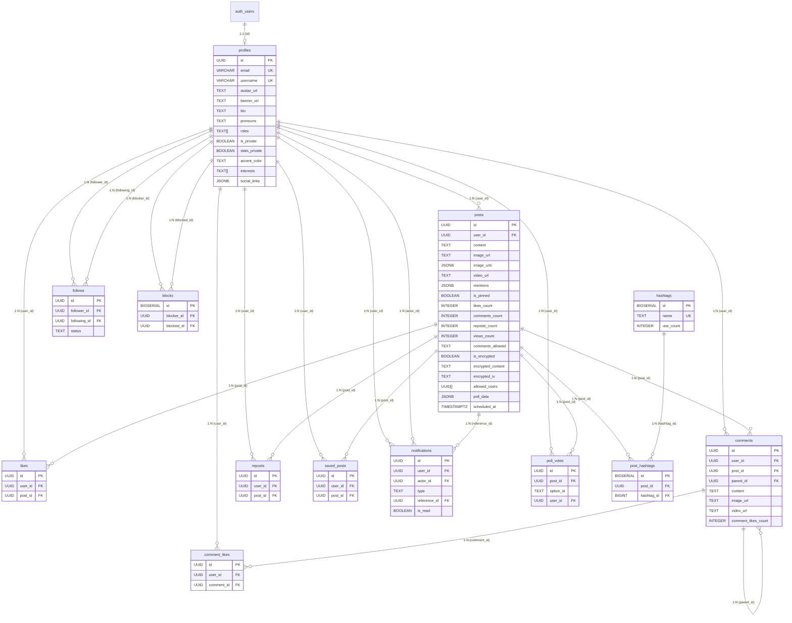

# Referencia de Supabase -- FastChange

Guia unificada de configuracion, esquema de base de datos y consultas SQL para el proyecto FastChange.

---

## Indice

1. [Configuracion inicial](#1-configuracion-inicial)
2. [Esquema de base de datos](#2-esquema-de-base-de-datos)
   - [Diagrama de relaciones (ER)](#diagrama-de-relaciones-er)
3. [Politicas de seguridad a nivel de fila (RLS)](#3-politicas-de-seguridad-a-nivel-de-fila-rls)
4. [Funciones y triggers](#4-funciones-y-triggers)
5. [Realtime](#5-realtime)
6. [Consultas utiles](#6-consultas-utiles)
7. [Troubleshooting](#7-troubleshooting)

---

## 1. Configuracion inicial

### 1.1 Crear proyecto en Supabase

1. Crear una cuenta en https://app.supabase.com
2. Crear un nuevo proyecto
3. Ir a Settings, API
4. Copiar la **Project URL** y la **anon / public key**

### 1.2 Variables de entorno

Crear el archivo `.env.local` en la raiz del proyecto:

```
VITE_SUPABASE_URL=https://<proyecto>.supabase.co
VITE_SUPABASE_ANON_KEY=<clave_anon>
```

Se admiten los siguientes nombres de variables alternativos:

| Variable principal | Alternativas admitidas |
|---|---|
| `VITE_SUPABASE_URL` | `VITE_SUPABASE_DATA_API_URL` |
| `VITE_SUPABASE_ANON_KEY` | `VITE_SUPABASE_PUBLISHABLE_KEY`, `VITE_SUPABASE_PUBLIC_KEY`, `VITE_SUPABASE_KEY` |

### 1.3 Estructura de archivos relacionada

```
src/
  context/
    AuthContext.jsx           -- Proveedor de contexto de autenticacion
  hooks/
    useAuth.js                -- Hook para acceder al contexto de autenticacion
  assets/services/
    supabaseclient.js         -- Cliente de Supabase (configuracion)
  assets/Pages/Sing/
    Login.jsx                 -- Pagina de inicio de sesion
    Register.jsx              -- Pagina de registro
```

### 1.4 Flujo de autenticacion

- **Registro**: Crea un usuario con correo electronico y contrasena
- **Inicio de sesion**: Permite iniciar sesion con correo electronico o nombre de usuario
- **Cierre de sesion**: Cierra la sesion y elimina el estado de autenticacion
- **useAuth**: Hook que expone el estado del usuario y las funciones de autenticacion

### 1.5 Ejemplo de uso

```jsx
import { useAuth } from '../hooks/useAuth';

function MiComponente() {
  const { user, login, logout, isAuthenticated } = useAuth();

  return (
    <div>
      {isAuthenticated ? (
        <button onClick={logout}>Cerrar sesion: {user.email}</button>
      ) : (
        <p>Inicie sesion para continuar</p>
      )}
    </div>
  );
}
```

### 1.6 Aplicar migraciones

Las migraciones SQL se encuentran en `src/assets/services/migrations/` y deben ejecutarse en orden numerico (001 a 030) desde el SQL Editor de Supabase:

1. Abrir https://app.supabase.com y seleccionar el proyecto
2. Ir a **SQL Editor** en la barra lateral izquierda
3. Hacer clic en **New query**
4. Copiar y pegar el contenido de cada archivo de migracion
5. Ejecutar cada consulta (Ctrl+Enter)
6. Verificar que no haya errores antes de pasar a la siguiente migracion

---

## 2. Esquema de base de datos

### 2.1 Tabla profiles

Almacena los perfiles de usuario.

```sql
CREATE TABLE IF NOT EXISTS profiles (
  id UUID PRIMARY KEY REFERENCES auth.users(id) ON DELETE CASCADE,
  email VARCHAR(255) NOT NULL UNIQUE,
  username VARCHAR(255) NOT NULL UNIQUE,
  avatar_url TEXT,
  banner_url TEXT,
  bio TEXT,
  pronouns TEXT,
  roles TEXT[] DEFAULT '{user}',
  created_at TIMESTAMPTZ DEFAULT NOW(),
  updated_at TIMESTAMPTZ DEFAULT NOW(),
  -- Privacidad
  is_private BOOLEAN DEFAULT false,
  stats_private BOOLEAN DEFAULT false,
  stats_visibility JSONB DEFAULT NULL,
  -- Intereses e información adicional
  interests TEXT[] DEFAULT '{}',
  social_links JSONB DEFAULT '[]'::jsonb,
  -- Canción del perfil (card con disco animado; preview 30s vía iTunes/Deezer
  -- o stream completo vía server yt-dlp — ver README)
  song JSONB DEFAULT NULL,
  -- Color de acento
  accent_color VARCHAR(7) DEFAULT NULL,
  accent_color_secondary TEXT DEFAULT NULL,
  accent_surface_color TEXT DEFAULT NULL,
  accent_surface_glass BOOLEAN DEFAULT false,
  accent_visibility TEXT DEFAULT 'both',
  show_accent_profile BOOLEAN DEFAULT true,
  show_accent_explore BOOLEAN DEFAULT true,
  -- Imagen de perfil y banner (posicion)
  banner_position TEXT DEFAULT '50% 50%',
  avatar_position TEXT DEFAULT '50% 50%',
  -- Imagen de fondo del perfil
  profile_background_url TEXT DEFAULT NULL,
  profile_background_position TEXT DEFAULT '50% 50%',
  profile_background_blur INTEGER DEFAULT 0,
  profile_background_dim INTEGER DEFAULT 50,
  -- Visibilidad de cards en el perfil
  show_interests BOOLEAN DEFAULT true,
  show_profile_stats BOOLEAN DEFAULT true,
  show_trending BOOLEAN DEFAULT true,
  -- Visibilidad de pestanas de likes/guardados
  show_likes BOOLEAN DEFAULT false,
  show_saves BOOLEAN DEFAULT false,
  -- Contadores
  profile_views_count INTEGER NOT NULL DEFAULT 0,
  -- Preferencias de privacidad
  allow_mention BOOLEAN DEFAULT true,
  allow_encrypted_add BOOLEAN DEFAULT true
);
```

**Indices:**

```sql
CREATE INDEX idx_profiles_username ON profiles(LOWER(username));
CREATE INDEX idx_profiles_email ON profiles(LOWER(email));
```

**Trigger de actualizacion automatica:**

```sql
CREATE OR REPLACE FUNCTION update_updated_at()
RETURNS TRIGGER AS $$
BEGIN
  NEW.updated_at = NOW();
  RETURN NEW;
END;
$$ LANGUAGE plpgsql;

CREATE TRIGGER update_profiles_updated_at
  BEFORE UPDATE ON profiles
  FOR EACH ROW
  EXECUTE FUNCTION update_updated_at();
```

### 2.2 Tabla posts

Almacena las publicaciones de los usuarios.

```sql
CREATE TABLE posts (
  id UUID DEFAULT gen_random_uuid() PRIMARY KEY,
  user_id UUID REFERENCES profiles(id) ON DELETE CASCADE NOT NULL,
  content TEXT NOT NULL,
  image_url TEXT,
  image_urls JSONB DEFAULT '[]'::jsonb,
  video_url TEXT,
  mentions JSONB DEFAULT '{}'::jsonb,
  is_pinned BOOLEAN DEFAULT false,
  pinned_at TIMESTAMPTZ,
  likes_count INTEGER DEFAULT 0,
  comments_count INTEGER DEFAULT 0,
  reposts_count INTEGER DEFAULT 0,
  views_count INTEGER NOT NULL DEFAULT 0,
  comments_allowed TEXT NOT NULL DEFAULT 'everyone'
    CHECK (comments_allowed IN ('everyone', 'followers', 'nobody')),
  -- Encriptacion
  is_encrypted BOOLEAN DEFAULT FALSE,
  encrypted_content TEXT,
  encrypted_iv TEXT,
  allowed_users UUID[] DEFAULT '{}',
  obfuscated_display TEXT,
  -- Encuestas
  poll_data JSONB,
  -- Programacion
  scheduled_at TIMESTAMPTZ,
  -- Timestamps
  created_at TIMESTAMPTZ DEFAULT now(),
  updated_at TIMESTAMPTZ DEFAULT now()
);
```

**Indices:**

```sql
CREATE INDEX idx_posts_user_id ON posts(user_id);
CREATE INDEX idx_posts_created_at ON posts(created_at DESC);
CREATE INDEX idx_posts_pinned ON posts(user_id, is_pinned) WHERE is_pinned = true;
CREATE INDEX idx_posts_allowed_users ON posts USING GIN (allowed_users);
CREATE INDEX idx_posts_scheduled_at ON posts(scheduled_at) WHERE scheduled_at IS NOT NULL;
```

### 2.3 Tabla likes

```sql
CREATE TABLE likes (
  id UUID DEFAULT gen_random_uuid() PRIMARY KEY,
  user_id UUID REFERENCES profiles(id) ON DELETE CASCADE NOT NULL,
  post_id UUID REFERENCES posts(id) ON DELETE CASCADE NOT NULL,
  created_at TIMESTAMPTZ DEFAULT now(),
  UNIQUE(user_id, post_id)
);
```

**Indices:**

```sql
CREATE INDEX idx_likes_user_id ON likes(user_id);
CREATE INDEX idx_likes_post_id ON likes(post_id);
```

### 2.4 Tabla comments

```sql
CREATE TABLE comments (
  id UUID DEFAULT gen_random_uuid() PRIMARY KEY,
  user_id UUID REFERENCES profiles(id) ON DELETE CASCADE NOT NULL,
  post_id UUID REFERENCES posts(id) ON DELETE CASCADE NOT NULL,
  parent_id UUID REFERENCES comments(id) ON DELETE CASCADE,
  content TEXT NOT NULL,
  image_url TEXT,
  video_url TEXT,
  comment_likes_count INTEGER DEFAULT 0,
  created_at TIMESTAMPTZ DEFAULT now(),
  updated_at TIMESTAMPTZ DEFAULT now()
);
```

**Indices:**

```sql
CREATE INDEX idx_comments_post_id ON comments(post_id);
CREATE INDEX idx_comments_user_id ON comments(user_id);
CREATE INDEX idx_comments_parent_id ON comments(parent_id) WHERE parent_id IS NOT NULL;
```

### 2.5 Tabla comment_likes

```sql
CREATE TABLE comment_likes (
  id UUID DEFAULT gen_random_uuid() PRIMARY KEY,
  user_id UUID REFERENCES profiles(id) ON DELETE CASCADE NOT NULL,
  comment_id UUID REFERENCES comments(id) ON DELETE CASCADE NOT NULL,
  created_at TIMESTAMPTZ DEFAULT now(),
  UNIQUE(user_id, comment_id)
);
```

**Indices:**

```sql
CREATE INDEX idx_comment_likes_user_id ON comment_likes(user_id);
CREATE INDEX idx_comment_likes_comment_id ON comment_likes(comment_id);
```

### 2.6 Tabla reposts

```sql
CREATE TABLE reposts (
  id UUID DEFAULT gen_random_uuid() PRIMARY KEY,
  user_id UUID REFERENCES profiles(id) ON DELETE CASCADE NOT NULL,
  post_id UUID REFERENCES posts(id) ON DELETE CASCADE NOT NULL,
  created_at TIMESTAMPTZ DEFAULT now(),
  UNIQUE(user_id, post_id)
);
```

**Indices:**

```sql
CREATE INDEX idx_reposts_user_id ON reposts(user_id);
CREATE INDEX idx_reposts_post_id ON reposts(post_id);
```

### 2.7 Tabla saved_posts

```sql
CREATE TABLE IF NOT EXISTS saved_posts (
  id UUID PRIMARY KEY DEFAULT gen_random_uuid(),
  user_id UUID NOT NULL REFERENCES profiles(id) ON DELETE CASCADE,
  post_id UUID NOT NULL REFERENCES posts(id) ON DELETE CASCADE,
  created_at TIMESTAMPTZ NOT NULL DEFAULT NOW(),
  UNIQUE(user_id, post_id)
);
```

**Indice:**

```sql
CREATE INDEX idx_saved_posts_user ON saved_posts(user_id, created_at DESC);
```

### 2.8 Tabla follows

```sql
CREATE TABLE follows (
  id UUID DEFAULT gen_random_uuid() PRIMARY KEY,
  follower_id UUID REFERENCES profiles(id) ON DELETE CASCADE NOT NULL,
  following_id UUID REFERENCES profiles(id) ON DELETE CASCADE NOT NULL,
  status TEXT NOT NULL DEFAULT 'accepted' CHECK (status IN ('accepted', 'pending')),
  created_at TIMESTAMPTZ DEFAULT now(),
  UNIQUE(follower_id, following_id)
);
```

**Indices:**

```sql
CREATE INDEX idx_follows_follower ON follows(follower_id);
CREATE INDEX idx_follows_following ON follows(following_id);
```

### 2.9 Tabla blocks

```sql
CREATE TABLE IF NOT EXISTS blocks (
  id BIGSERIAL PRIMARY KEY,
  blocker_id UUID NOT NULL REFERENCES profiles(id) ON DELETE CASCADE,
  blocked_id UUID NOT NULL REFERENCES profiles(id) ON DELETE CASCADE,
  created_at TIMESTAMPTZ DEFAULT now(),
  UNIQUE(blocker_id, blocked_id),
  CONSTRAINT blocks_no_self_block CHECK (blocker_id <> blocked_id)
);
```

**Indices:**

```sql
CREATE INDEX idx_blocks_blocker ON blocks(blocker_id);
CREATE INDEX idx_blocks_blocked ON blocks(blocked_id);
```

**Configuracion de REPLICA IDENTITY:**

```sql
ALTER TABLE blocks REPLICA IDENTITY FULL;
```

### 2.10 Tabla notifications

```sql
CREATE TABLE notifications (
  id UUID PRIMARY KEY DEFAULT gen_random_uuid(),
  user_id UUID NOT NULL REFERENCES profiles(id) ON DELETE CASCADE,
  actor_id UUID NOT NULL REFERENCES profiles(id) ON DELETE CASCADE,
  type TEXT NOT NULL CHECK (type IN (
    'follow', 'follow_request', 'follow_request_accepted', 'follow_request_rejected',
    'like', 'comment', 'repost', 'comment_like', 'mention',
    'encrypted_add', 'poll_vote'
  )),
  reference_id UUID REFERENCES posts(id) ON DELETE CASCADE,
  is_read BOOLEAN NOT NULL DEFAULT FALSE,
  created_at TIMESTAMPTZ NOT NULL DEFAULT NOW()
);
```

**Indices:**

```sql
CREATE INDEX idx_notifications_user ON notifications(user_id, created_at DESC);
CREATE INDEX idx_notifications_unread ON notifications(user_id, is_read) WHERE is_read = FALSE;
```

### 2.11 Tabla hashtags

```sql
CREATE TABLE IF NOT EXISTS hashtags (
  id BIGSERIAL PRIMARY KEY,
  name TEXT UNIQUE NOT NULL,
  created_at TIMESTAMPTZ DEFAULT NOW(),
  last_used_at TIMESTAMPTZ DEFAULT NOW(),
  use_count INTEGER DEFAULT 1
);
```

**Indices:**

```sql
CREATE INDEX idx_hashtags_use_count ON hashtags(use_count DESC);
CREATE INDEX idx_hashtags_last_used ON hashtags(last_used_at DESC);
```

### 2.12 Tabla post_hashtags

```sql
CREATE TABLE IF NOT EXISTS post_hashtags (
  id BIGSERIAL PRIMARY KEY,
  post_id UUID REFERENCES posts(id) ON DELETE CASCADE,
  hashtag_id BIGINT REFERENCES hashtags(id) ON DELETE CASCADE,
  created_at TIMESTAMPTZ DEFAULT NOW(),
  UNIQUE(post_id, hashtag_id)
);
```

**Indices:**

```sql
CREATE INDEX idx_post_hashtags_post_id ON post_hashtags(post_id);
CREATE INDEX idx_post_hashtags_hashtag_id ON post_hashtags(hashtag_id);
```

### 2.13 Tabla poll_votes

```sql
CREATE TABLE IF NOT EXISTS poll_votes (
  id UUID PRIMARY KEY DEFAULT gen_random_uuid(),
  post_id UUID NOT NULL REFERENCES posts(id) ON DELETE CASCADE,
  option_id TEXT NOT NULL,
  user_id UUID NOT NULL REFERENCES profiles(id) ON DELETE CASCADE,
  created_at TIMESTAMPTZ NOT NULL DEFAULT NOW(),
  UNIQUE(post_id, user_id)
);
```

**Indices:**

```sql
CREATE INDEX idx_poll_votes_post_id ON poll_votes(post_id);
CREATE INDEX idx_poll_votes_user_id ON poll_votes(user_id);
```

### Diagrama de relaciones (ER)



---

## 3. Politicas de seguridad a nivel de fila (RLS)

### profiles

```sql
ALTER TABLE profiles ENABLE ROW LEVEL SECURITY;

-- Los usuarios pueden ver su propio perfil
CREATE POLICY "Users can view their own profile"
  ON profiles FOR SELECT
  USING (auth.uid() = id);

-- Los usuarios pueden actualizar su propio perfil
CREATE POLICY "Users can update their own profile"
  ON profiles FOR UPDATE
  USING (auth.uid() = id);

-- Los usuarios pueden crear su propio perfil
CREATE POLICY "Users can insert their own profile"
  ON profiles FOR INSERT
  WITH CHECK (auth.uid() = id);

-- Los perfiles son visibles publicamente
CREATE POLICY "Public profiles are viewable by everyone"
  ON profiles FOR SELECT
  USING (true);
```

### posts

```sql
ALTER TABLE posts ENABLE ROW LEVEL SECURITY;

CREATE POLICY "Anyone can view posts" ON posts FOR SELECT USING (true);
CREATE POLICY "Users can create posts" ON posts FOR INSERT WITH CHECK (auth.uid() = user_id);
CREATE POLICY "Users can update own posts" ON posts FOR UPDATE USING (auth.uid() = user_id);
CREATE POLICY "Users can delete own posts" ON posts FOR DELETE USING (auth.uid() = user_id);
```

### likes

```sql
ALTER TABLE likes ENABLE ROW LEVEL SECURITY;

CREATE POLICY "Anyone can view likes" ON likes FOR SELECT USING (true);
CREATE POLICY "Users can create likes" ON likes FOR INSERT WITH CHECK (auth.uid() = user_id);
CREATE POLICY "Users can delete own likes" ON likes FOR DELETE USING (auth.uid() = user_id);
```

### comments

```sql
ALTER TABLE comments ENABLE ROW LEVEL SECURITY;

CREATE POLICY "Anyone can view comments" ON comments FOR SELECT USING (true);
CREATE POLICY "Users can create comments" ON comments FOR INSERT WITH CHECK (auth.uid() = user_id);
CREATE POLICY "Users can update own comments" ON comments FOR UPDATE USING (auth.uid() = user_id);
CREATE POLICY "Users can delete own comments" ON comments FOR DELETE USING (auth.uid() = user_id);
```

### comment_likes

```sql
ALTER TABLE comment_likes ENABLE ROW LEVEL SECURITY;

CREATE POLICY "Anyone can view comment likes" ON comment_likes FOR SELECT USING (true);
CREATE POLICY "Users can create comment likes" ON comment_likes FOR INSERT WITH CHECK (auth.uid() = user_id);
CREATE POLICY "Users can delete own comment likes" ON comment_likes FOR DELETE USING (auth.uid() = user_id);
```

### reposts

```sql
ALTER TABLE reposts ENABLE ROW LEVEL SECURITY;

CREATE POLICY "Anyone can view reposts" ON reposts FOR SELECT USING (true);

-- Politica con verificacion de perfil privado
DROP POLICY IF EXISTS "Users can create reposts" ON reposts;
CREATE POLICY "Users can create reposts" ON reposts
  FOR INSERT
  WITH CHECK (
    auth.uid() = user_id
    AND can_repost_post(user_id, post_id)
  );

CREATE POLICY "Users can delete own reposts" ON reposts FOR DELETE USING (auth.uid() = user_id);
```

### saved_posts

```sql
ALTER TABLE saved_posts ENABLE ROW LEVEL SECURITY;

CREATE POLICY "Users can view their own saves" ON saved_posts FOR SELECT USING (auth.uid() = user_id);
CREATE POLICY "Users can insert their own saves" ON saved_posts FOR INSERT WITH CHECK (auth.uid() = user_id);
CREATE POLICY "Users can delete their own saves" ON saved_posts FOR DELETE USING (auth.uid() = user_id);
```

### follows

```sql
-- Politicas de seguimiento
-- INSERT: el usuario autenticado puede seguir a otros
-- INSERT: el propietario de un perfil privado puede aceptar solicitudes
-- DELETE: el usuario puede dejar de seguir
-- DELETE: el propietario de un perfil privado puede rechazar solicitudes

CREATE POLICY "Users can accept follow requests"
  ON follows FOR INSERT
  WITH CHECK (auth.uid() = following_id);

CREATE POLICY "Users can reject follow requests"
  ON follows FOR DELETE
  USING (auth.uid() = following_id AND status = 'pending');
```

### blocks

```sql
ALTER TABLE blocks ENABLE ROW LEVEL SECURITY;

CREATE POLICY blocks_insert_policy ON blocks
  FOR INSERT TO authenticated
  WITH CHECK (blocker_id = auth.uid());

CREATE POLICY blocks_delete_policy ON blocks
  FOR DELETE TO authenticated
  USING (blocker_id = auth.uid());

CREATE POLICY blocks_select_own_policy ON blocks
  FOR SELECT TO authenticated
  USING (blocker_id = auth.uid());

CREATE POLICY blocks_select_blocked_policy ON blocks
  FOR SELECT TO authenticated
  USING (blocked_id = auth.uid());
```

### notifications

```sql
ALTER TABLE notifications ENABLE ROW LEVEL SECURITY;

CREATE POLICY "Users can view their own notifications"
  ON notifications FOR SELECT
  USING (auth.uid() = user_id);

CREATE POLICY "Users can create notifications as actor"
  ON notifications FOR INSERT
  WITH CHECK (auth.uid() = actor_id);

CREATE POLICY "Users can delete their own notifications"
  ON notifications FOR DELETE
  USING (auth.uid() = user_id);
```

### hashtags y post_hashtags

```sql
ALTER TABLE hashtags ENABLE ROW LEVEL SECURITY;
ALTER TABLE post_hashtags ENABLE ROW LEVEL SECURITY;

CREATE POLICY "Anyone can read hashtags" ON hashtags FOR SELECT USING (true);
CREATE POLICY "Anyone can read post_hashtags" ON post_hashtags FOR SELECT USING (true);
CREATE POLICY "Authenticated users can insert post_hashtags" ON post_hashtags
  FOR INSERT WITH CHECK (auth.role() = 'authenticated');
```

### poll_votes

```sql
ALTER TABLE poll_votes ENABLE ROW LEVEL SECURITY;

CREATE POLICY poll_votes_insert ON poll_votes
  FOR INSERT TO authenticated
  WITH CHECK (auth.uid() = user_id);

CREATE POLICY poll_votes_select ON poll_votes
  FOR SELECT TO authenticated
  USING (true);

CREATE POLICY poll_votes_delete ON poll_votes
  FOR DELETE TO authenticated
  USING (auth.uid() = user_id);
```

---

## 4. Funciones y triggers

### 4.1 Contadores desnormalizados (SECURITY DEFINER)

```sql
-- Likes
CREATE OR REPLACE FUNCTION increment_likes_count() RETURNS TRIGGER SECURITY DEFINER AS $$
BEGIN
  UPDATE posts SET likes_count = likes_count + 1 WHERE id = NEW.post_id;
  RETURN NEW;
END;
$$ LANGUAGE plpgsql;

CREATE OR REPLACE FUNCTION decrement_likes_count() RETURNS TRIGGER SECURITY DEFINER AS $$
BEGIN
  UPDATE posts SET likes_count = GREATEST(likes_count - 1, 0) WHERE id = OLD.post_id;
  RETURN OLD;
END;
$$ LANGUAGE plpgsql;

CREATE TRIGGER on_like_insert AFTER INSERT ON likes FOR EACH ROW EXECUTE FUNCTION increment_likes_count();
CREATE TRIGGER on_like_delete AFTER DELETE ON likes FOR EACH ROW EXECUTE FUNCTION decrement_likes_count();

-- Comentarios
CREATE OR REPLACE FUNCTION increment_comments_count() RETURNS TRIGGER SECURITY DEFINER AS $$
BEGIN
  UPDATE posts SET comments_count = comments_count + 1 WHERE id = NEW.post_id;
  RETURN NEW;
END;
$$ LANGUAGE plpgsql;

CREATE OR REPLACE FUNCTION decrement_comments_count() RETURNS TRIGGER SECURITY DEFINER AS $$
BEGIN
  UPDATE posts SET comments_count = GREATEST(comments_count - 1, 0) WHERE id = OLD.post_id;
  RETURN OLD;
END;
$$ LANGUAGE plpgsql;

CREATE TRIGGER on_comment_insert AFTER INSERT ON comments FOR EACH ROW EXECUTE FUNCTION increment_comments_count();
CREATE TRIGGER on_comment_delete AFTER DELETE ON comments FOR EACH ROW EXECUTE FUNCTION decrement_comments_count();

-- Reposts
CREATE OR REPLACE FUNCTION increment_reposts_count() RETURNS TRIGGER SECURITY DEFINER AS $$
BEGIN
  UPDATE posts SET reposts_count = reposts_count + 1 WHERE id = NEW.post_id;
  RETURN NEW;
END;
$$ LANGUAGE plpgsql;

CREATE OR REPLACE FUNCTION decrement_reposts_count() RETURNS TRIGGER SECURITY DEFINER AS $$
BEGIN
  UPDATE posts SET reposts_count = GREATEST(reposts_count - 1, 0) WHERE id = OLD.post_id;
  RETURN OLD;
END;
$$ LANGUAGE plpgsql;

CREATE TRIGGER on_repost_insert AFTER INSERT ON reposts FOR EACH ROW EXECUTE FUNCTION increment_reposts_count();
CREATE TRIGGER on_repost_delete AFTER DELETE ON reposts FOR EACH ROW EXECUTE FUNCTION decrement_reposts_count();

-- Likes en comentarios
CREATE OR REPLACE FUNCTION increment_comment_likes_count() RETURNS TRIGGER SECURITY DEFINER AS $$
BEGIN
  UPDATE comments SET comment_likes_count = comment_likes_count + 1 WHERE id = NEW.comment_id;
  RETURN NEW;
END;
$$ LANGUAGE plpgsql;

CREATE OR REPLACE FUNCTION decrement_comment_likes_count() RETURNS TRIGGER SECURITY DEFINER AS $$
BEGIN
  UPDATE comments SET comment_likes_count = GREATEST(comment_likes_count - 1, 0) WHERE id = OLD.comment_id;
  RETURN OLD;
END;
$$ LANGUAGE plpgsql;

CREATE TRIGGER on_comment_like_insert AFTER INSERT ON comment_likes FOR EACH ROW EXECUTE FUNCTION increment_comment_likes_count();
CREATE TRIGGER on_comment_like_delete AFTER DELETE ON comment_likes FOR EACH ROW EXECUTE FUNCTION decrement_comment_likes_count();
```

### 4.2 Notificaciones automaticas (SECURITY DEFINER)

```sql
-- Notificacion de like
CREATE OR REPLACE FUNCTION notify_like() RETURNS TRIGGER SECURITY DEFINER AS $$
DECLARE post_owner_id UUID;
BEGIN
  SELECT user_id INTO post_owner_id FROM posts WHERE id = NEW.post_id;
  IF post_owner_id IS NOT NULL AND post_owner_id != NEW.user_id THEN
    INSERT INTO notifications (user_id, actor_id, type, reference_id)
    VALUES (post_owner_id, NEW.user_id, 'like', NEW.post_id);
  END IF;
  RETURN NEW;
END;
$$ LANGUAGE plpgsql;

CREATE TRIGGER on_notify_like AFTER INSERT ON likes FOR EACH ROW EXECUTE FUNCTION notify_like();

-- Notificacion de comentario
CREATE OR REPLACE FUNCTION notify_comment() RETURNS TRIGGER SECURITY DEFINER AS $$
DECLARE post_owner_id UUID;
BEGIN
  SELECT user_id INTO post_owner_id FROM posts WHERE id = NEW.post_id;
  IF post_owner_id IS NOT NULL AND post_owner_id != NEW.user_id THEN
    INSERT INTO notifications (user_id, actor_id, type, reference_id)
    VALUES (post_owner_id, NEW.user_id, 'comment', NEW.post_id);
  END IF;
  RETURN NEW;
END;
$$ LANGUAGE plpgsql;

CREATE TRIGGER on_notify_comment AFTER INSERT ON comments FOR EACH ROW EXECUTE FUNCTION notify_comment();

-- Notificacion de repost
CREATE OR REPLACE FUNCTION notify_repost() RETURNS TRIGGER SECURITY DEFINER AS $$
DECLARE post_owner_id UUID;
BEGIN
  SELECT user_id INTO post_owner_id FROM posts WHERE id = NEW.post_id;
  IF post_owner_id IS NOT NULL AND post_owner_id != NEW.user_id THEN
    INSERT INTO notifications (user_id, actor_id, type, reference_id)
    VALUES (post_owner_id, NEW.user_id, 'repost', NEW.post_id);
  END IF;
  RETURN NEW;
END;
$$ LANGUAGE plpgsql;

CREATE TRIGGER on_notify_repost AFTER INSERT ON reposts FOR EACH ROW EXECUTE FUNCTION notify_repost();

-- Notificacion de like en comentario
CREATE OR REPLACE FUNCTION notify_comment_like() RETURNS TRIGGER SECURITY DEFINER AS $$
DECLARE comment_owner_id UUID; comment_post_id UUID;
BEGIN
  SELECT user_id, post_id INTO comment_owner_id, comment_post_id FROM comments WHERE id = NEW.comment_id;
  IF comment_owner_id IS NOT NULL AND comment_owner_id != NEW.user_id THEN
    INSERT INTO notifications (user_id, actor_id, type, reference_id)
    VALUES (comment_owner_id, NEW.user_id, 'comment_like', comment_post_id);
  END IF;
  RETURN NEW;
END;
$$ LANGUAGE plpgsql;

CREATE TRIGGER on_notify_comment_like AFTER INSERT ON comment_likes FOR EACH ROW EXECUTE FUNCTION notify_comment_like();
```

### 4.3 Hashtags

```sql
-- Upsert de hashtag con incremento de uso
CREATE OR REPLACE FUNCTION bump_hashtag_usage(p_name TEXT) RETURNS BIGINT
LANGUAGE plpgsql SECURITY DEFINER AS $$
DECLARE h_id BIGINT;
BEGIN
  INSERT INTO hashtags (name, use_count, last_used_at)
  VALUES (LOWER(p_name), 1, NOW())
  ON CONFLICT (name) DO UPDATE SET
    use_count = hashtags.use_count + 1,
    last_used_at = NOW()
  RETURNING id INTO h_id;
  RETURN h_id;
END;
$$;

-- Limpieza de hashtags huérfanos al eliminar un post
CREATE OR REPLACE FUNCTION cleanup_post_hashtags() RETURNS TRIGGER
LANGUAGE plpgsql SECURITY DEFINER AS $$
BEGIN
  UPDATE hashtags h
  SET use_count = GREATEST(use_count - 1, 0)
  FROM post_hashtags ph
  WHERE ph.hashtag_id = h.id AND ph.post_id = OLD.id;

  DELETE FROM hashtags WHERE use_count <= 0;
  RETURN OLD;
END;
$$;

DROP TRIGGER IF EXISTS trg_cleanup_post_hashtags ON posts;
CREATE TRIGGER trg_cleanup_post_hashtags
  AFTER DELETE ON posts FOR EACH ROW EXECUTE FUNCTION cleanup_post_hashtags();
```

### 4.4 Bloqueo: eliminar seguimiento bidireccional

```sql
CREATE OR REPLACE FUNCTION unfollow_both_ways(blocker_id UUID, blocked_id UUID)
RETURNS void LANGUAGE plpgsql SECURITY DEFINER SET search_path = public AS $$
BEGIN
  DELETE FROM follows WHERE follower_id = blocker_id AND following_id = blocked_id;
  DELETE FROM follows WHERE follower_id = blocked_id AND following_id = blocker_id;
END;
$$;
```

### 4.5 Restriccion de reposts en perfiles privados

```sql
CREATE OR REPLACE FUNCTION can_repost_post(p_user_id UUID, p_post_id UUID)
RETURNS BOOLEAN AS $$
DECLARE post_owner_is_private BOOLEAN; post_owner_id UUID;
BEGIN
  SELECT p.user_id, pr.is_private INTO post_owner_id, post_owner_is_private
  FROM posts p JOIN profiles pr ON pr.id = p.user_id WHERE p.id = p_post_id;

  IF post_owner_id IS NULL THEN RETURN TRUE; END IF;
  IF post_owner_is_private AND p_user_id != post_owner_id THEN RETURN FALSE; END IF;
  RETURN TRUE;
END;
$$ LANGUAGE plpgsql SECURITY DEFINER;
```

### 4.6 Palabras en tendencia (RPC)

```sql
CREATE OR REPLACE FUNCTION get_trending_words(limit_count INT DEFAULT 8, hours_back INT DEFAULT 24)
RETURNS TABLE(word TEXT, frequency BIGINT)
LANGUAGE plpgsql SECURITY DEFINER AS $$
BEGIN
  RETURN QUERY
  SELECT LOWER(unnested)::TEXT AS word, COUNT(*)::BIGINT AS frequency
  FROM (
    SELECT regexp_split_to_table(
      regexp_replace(
        regexp_replace(
          regexp_replace(
            LOWER(COALESCE(content, '')),
            'https?://\\S+', '', 'g'
          ), '@[a-zA-Z0-9_]+', '', 'g'
        ), '#[a-zA-Z0-9_\\u00C0-\\u024F]+', '', 'g'
      ), '[^a-zA-Z0-9\\u00C0-\\u024F]+'
    ) AS unnested
    FROM posts
    JOIN profiles ON profiles.id = posts.user_id
    WHERE posts.created_at > NOW() - (hours_back || ' hours')::INTERVAL
      AND posts.content IS NOT NULL AND posts.content != ''
      AND (profiles.is_private IS NULL OR profiles.is_private = false)
      AND (posts.is_encrypted IS NOT TRUE OR posts.is_encrypted IS NULL)
  ) words
  WHERE LENGTH(unnested) >= 4
    AND unnested !~ '^\\d+$'
    AND unnested NOT IN ('this','that','with','from','have','been','they','them','their',
      'will','would','could','should','about','which','when','where','what','there','your',
      'more','some','than','then','also','just','like','into','over','such','only','other',
      'very','much','still','well','even','back','here','down','after','before','between',
      'through','during','because','these','those','while','every','another','first','last',
      'great','good','really','think','know','want','need','make','take','come','look','give',
      'use','find','tell','ask','seem','feel','work','call','try','leave','keep','let','begin',
      'show','hear','play','run','move','live','believe','happen','write','read','help','start',
      'right','ever','never','always','away','today','going','getting','looking','made','said',
      'does','done','having','thing','things','people','person','place','time','way','day','year',
      'week','month','part','world','life','hand','eye','face','head','mind','heart','body','book',
      'word','name','house','friend','family','man','woman','men','women','father','mother',
      'brother','sister','water','food','money','air','land','light','power','love','fear','hope',
      'fun','god','child','doesn','don','didn','wasn','aren','isn','weren','hasn','hadn','won',
      'wouldn','shouldn','couldn','can','may','might','shall','needn','dare','ought',
      'este','esta','esto','estos','estas','ese','esa','esos','esas','aquel','aquella',
      'aquellos','aquellas','todo','toda','todos','todas','mismo','misma','mismos','mismas',
      'otro','otra','otros','otras','tanto','tanta','tantos','tantas','cada','cual','cuales',
      'quien','quienes','cuando','donde','como','que','cuyo','cuya','cuyos','cuyas','entre',
      'durante','mediante','excepto','salvo','incluso','mas','pero','sino','aunque','porque',
      'pues','puesto','ya','bien','sea','tan','cuanto','mientras','apenas','ni','siquiera',
      'aun','ademas','tambien','entonces','luego','despues','antes','pronto','temprano','tarde',
      'ahora','ayer','hoy','manana','noche','dia','semana','mes','ano','nunca','jamas','siempre',
      'aca','alli','alla','aqui','ahi','muy','mucho','poco','bastante','demasiado','asi','casi',
      'solo','solamente','encima','debajo','dentro','fuera','cerca','lejos','arriba','abajo',
      'mayor','menor','mejor','peor','superior','inferior','primer','primero','ultimo',
      'siguiente','anterior','propio','ajeno','comun','general','diferente','distinto',
      'semejante','parecido','cierto','falso','verdadero','bueno','malo','simple','dificil',
      'facil','posible','imposible','necesario','importante','especial','principal','gran',
      'grande','pequeno','largo','corto','alto','bajo','ancho','estrecho','profundo',
      'superficial','claro','oscuro','frio','caliente','dulce','amargo','salado','agrio',
      'nuevo','viejo','joven','antiguo','moderno','futuro','pasado','presente','saber','poder',
      'deber','querer','poner','decir','hacer','creer','pensar','encontrar','entender',
      'recordar','olvidar','perder','ganar','esperar','deseAr','amar','odiar','preferir',
      'elegir','decidir','aceptar','rechazar','permitir','prohibir','lograr','conseguir',
      'cambiar','mejorar','empeorar','crear','destruir','construir','romper','abrir','cerrar',
      'subir','bajar','entrar','salir','llegar','partir','volver','seguir','continuar',
      'terminar','acabar','empezar','comenzar','sonreir','llorar','reir','gritar','susurrar',
      'contar','explicar','responder','preguntar','hablar','conversar','llamar','enviar',
      'recibir','ofrecer','pedir','dar','tener','comer','beber','dormir','despertar','vestir',
      'cenar','comprar','vender','pagar','costar','valer')
    AND NOT EXISTS (SELECT 1 FROM hashtags h WHERE h.name = unnested)
  GROUP BY LOWER(unnested)
  HAVING COUNT(*) >= 2
  ORDER BY COUNT(*) DESC, LOWER(unnested) ASC
  LIMIT limit_count;
END;
$$;
```

### 4.7 Mencion de notificacion

```sql
CREATE OR REPLACE FUNCTION create_mention_notification(
  p_actor_id UUID, p_user_id UUID, p_reference_id UUID
) RETURNS VOID LANGUAGE plpgsql SECURITY DEFINER AS $$
BEGIN
  INSERT INTO notifications (actor_id, user_id, type, reference_id)
  VALUES (p_actor_id, p_user_id, 'mention', p_reference_id)
  ON CONFLICT DO NOTHING;
END;
$$;
```

---

## 5. Realtime

Las siguientes tablas deben estar incluidas en la publicacion `supabase_realtime` para que las suscripciones en tiempo real funcionen:

```sql
-- Agregar tablas a la publicacion Realtime (verificar antes de ejecutar)
DO $$ BEGIN
  IF NOT EXISTS (SELECT 1 FROM pg_publication_tables WHERE pubname = 'supabase_realtime' AND tablename = 'posts') THEN
    ALTER PUBLICATION supabase_realtime ADD TABLE posts;
  END IF;
END $$;

DO $$ BEGIN
  IF NOT EXISTS (SELECT 1 FROM pg_publication_tables WHERE pubname = 'supabase_realtime' AND tablename = 'notifications') THEN
    ALTER PUBLICATION supabase_realtime ADD TABLE notifications;
  END IF;
END $$;

DO $$ BEGIN
  IF NOT EXISTS (SELECT 1 FROM pg_publication_tables WHERE pubname = 'supabase_realtime' AND tablename = 'reposts') THEN
    ALTER PUBLICATION supabase_realtime ADD TABLE reposts;
  END IF;
END $$;

DO $$ BEGIN
  IF NOT EXISTS (SELECT 1 FROM pg_publication_tables WHERE pubname = 'supabase_realtime' AND tablename = 'comments') THEN
    ALTER PUBLICATION supabase_realtime ADD TABLE comments;
  END IF;
END $$;

DO $$ BEGIN
  IF NOT EXISTS (SELECT 1 FROM pg_publication_tables WHERE pubname = 'supabase_realtime' AND tablename = 'comment_likes') THEN
    ALTER PUBLICATION supabase_realtime ADD TABLE comment_likes;
  END IF;
END $$;

DO $$ BEGIN
  IF NOT EXISTS (SELECT 1 FROM pg_publication_tables WHERE pubname = 'supabase_realtime' AND tablename = 'likes') THEN
    ALTER PUBLICATION supabase_realtime ADD TABLE likes;
  END IF;
END $$;

DO $$ BEGIN
  IF NOT EXISTS (SELECT 1 FROM pg_publication_tables WHERE pubname = 'supabase_realtime' AND tablename = 'saved_posts') THEN
    ALTER PUBLICATION supabase_realtime ADD TABLE saved_posts;
  END IF;
END $$;

DO $$ BEGIN
  IF NOT EXISTS (SELECT 1 FROM pg_publication_tables WHERE pubname = 'supabase_realtime' AND tablename = 'blocks') THEN
    ALTER PUBLICATION supabase_realtime ADD TABLE blocks;
  END IF;
END $$;

DO $$ BEGIN
  IF NOT EXISTS (SELECT 1 FROM pg_publication_tables WHERE pubname = 'supabase_realtime' AND tablename = 'hashtags') THEN
    ALTER PUBLICATION supabase_realtime ADD TABLE hashtags;
  END IF;
END $$;

DO $$ BEGIN
  IF NOT EXISTS (SELECT 1 FROM pg_publication_tables WHERE pubname = 'supabase_realtime' AND tablename = 'post_hashtags') THEN
    ALTER PUBLICATION supabase_realtime ADD TABLE post_hashtags;
  END IF;
END $$;

DO $$ BEGIN
  IF NOT EXISTS (SELECT 1 FROM pg_publication_tables WHERE pubname = 'supabase_realtime' AND tablename = 'poll_votes') THEN
    ALTER PUBLICATION supabase_realtime ADD TABLE poll_votes;
  END IF;
END $$;
```

La tabla `blocks` requiere `REPLICA IDENTITY FULL` para que los eventos DELETE incluyan todas las columnas:

```sql
ALTER TABLE blocks REPLICA IDENTITY FULL;
```

---

## 6. Consultas utiles

### Perfiles

```sql
-- Ver todos los perfiles
SELECT * FROM profiles;

-- Buscar un perfil por username
SELECT * FROM profiles WHERE LOWER(username) = 'testuser';

-- Buscar un perfil por email
SELECT * FROM profiles WHERE LOWER(email) = 'test@example.com';

-- Contar total de usuarios
SELECT COUNT(*) FROM profiles;
```

### Publicaciones

```sql
-- Obtener posts con perfil del autor
SELECT p.*, pr.username, pr.avatar_url
FROM posts p
JOIN profiles pr ON pr.id = p.user_id
ORDER BY p.created_at DESC;

-- Obtener posts fijados de un usuario
SELECT * FROM posts
WHERE user_id = 'user_id' AND is_pinned = true
ORDER BY pinned_at DESC;
```

### Notificaciones

```sql
-- Obtener notificaciones con datos del actor
SELECT n.*, p.username, p.avatar_url
FROM notifications n
JOIN profiles p ON p.id = n.actor_id
WHERE n.user_id = 'mi-id'
ORDER BY n.created_at DESC;

-- Marcar todas como leidas
UPDATE notifications SET is_read = TRUE
WHERE user_id = 'mi-id' AND is_read = FALSE;

-- Contar no leidas
SELECT COUNT(*) FROM notifications
WHERE user_id = 'mi-id' AND is_read = FALSE;
```

### Eliminar datos (solo testing)

```sql
-- Eliminar un perfil
DELETE FROM profiles WHERE id = 'user_id_here';

-- Resetear la tabla de perfiles (CUIDADO: borra todos los datos)
TRUNCATE TABLE profiles CASCADE;
```

---

## 7. Troubleshooting

### Tabla ya existe

```sql
DROP TABLE IF EXISTS profiles CASCADE;
```

### Resetear una tabla (borra todos los datos)

```sql
TRUNCATE TABLE profiles CASCADE;
```

### Eliminar triggers y funciones (para regenerar desde cero)

```sql
DROP TRIGGER IF EXISTS on_like_insert ON likes;
DROP TRIGGER IF EXISTS on_like_delete ON likes;
DROP TRIGGER IF EXISTS on_comment_insert ON comments;
DROP TRIGGER IF EXISTS on_comment_delete ON comments;
DROP TRIGGER IF EXISTS on_repost_insert ON reposts;
DROP TRIGGER IF EXISTS on_repost_delete ON reposts;
DROP TRIGGER IF EXISTS on_notify_like ON likes;
DROP TRIGGER IF EXISTS on_notify_comment ON comments;
DROP TRIGGER IF EXISTS on_notify_repost ON reposts;
DROP TRIGGER IF EXISTS on_notify_comment_like ON comment_likes;
DROP TRIGGER IF EXISTS on_comment_like_insert ON comment_likes;
DROP TRIGGER IF EXISTS on_comment_like_delete ON comment_likes;
DROP TRIGGER IF EXISTS trg_cleanup_post_hashtags ON posts;

DROP FUNCTION IF EXISTS increment_likes_count();
DROP FUNCTION IF EXISTS decrement_likes_count();
DROP FUNCTION IF EXISTS increment_comments_count();
DROP FUNCTION IF EXISTS decrement_comments_count();
DROP FUNCTION IF EXISTS increment_reposts_count();
DROP FUNCTION IF EXISTS decrement_reposts_count();
DROP FUNCTION IF EXISTS increment_comment_likes_count();
DROP FUNCTION IF EXISTS decrement_comment_likes_count();
DROP FUNCTION IF EXISTS notify_like();
DROP FUNCTION IF EXISTS notify_comment();
DROP FUNCTION IF EXISTS notify_repost();
DROP FUNCTION IF EXISTS notify_comment_like();
DROP FUNCTION IF EXISTS can_repost_post(UUID, UUID);
DROP FUNCTION IF EXISTS unfollow_both_ways(UUID, UUID);
DROP FUNCTION IF EXISTS bump_hashtag_usage(TEXT);
DROP FUNCTION IF EXISTS cleanup_post_hashtags();
DROP FUNCTION IF EXISTS create_mention_notification(UUID, UUID, UUID);
```

### Eliminar tablas (orden inverso por foreign keys)

```sql
DROP TABLE IF EXISTS poll_votes CASCADE;
DROP TABLE IF EXISTS post_hashtags CASCADE;
DROP TABLE IF EXISTS hashtags CASCADE;
DROP TABLE IF EXISTS saved_posts CASCADE;
DROP TABLE IF EXISTS notifications CASCADE;
DROP TABLE IF EXISTS blocks CASCADE;
DROP TABLE IF EXISTS follows CASCADE;
DROP TABLE IF EXISTS comment_likes CASCADE;
DROP TABLE IF EXISTS reposts CASCADE;
DROP TABLE IF EXISTS comments CASCADE;
DROP TABLE IF EXISTS likes CASCADE;
DROP TABLE IF EXISTS posts CASCADE;
DROP TABLE IF EXISTS profiles CASCADE;
```
